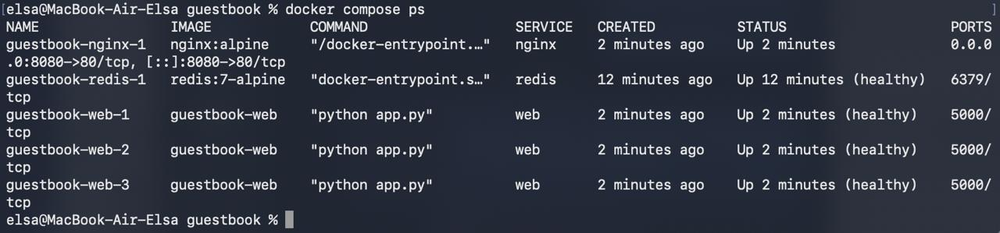
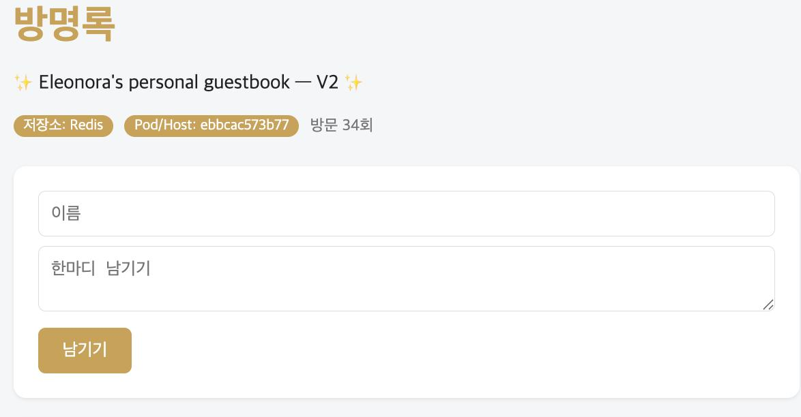

# Week 07 — Docker Compose, Nginx, Healthcheck

## 1. Docker Compose

`docker compose up -d --scale web=3` was used to run:

- 3 web containers
- 1 Redis container
- 1 Nginx container

## 2. Healthcheck

The result of `docker compose ps` showed that Redis and all web containers became `healthy`.

Screenshot:

## 3. Web Scaling

The web service was scaled to 3 containers.

Container IDs observed:

- `guestbook-web-1` → `bed772790869`
- `guestbook-web-2` → `ebbcac573b77`
- `guestbook-web-3` → `6b59a060bc36`

After refreshing `http://localhost:8080`, the `Pod/Host` value changed between different web containers.

Screenshots:

## 4. down/up vs down -v/up

- `docker compose down` → `docker compose up -d`: the Redis data remained because the `redis-data` volume was preserved.
- `docker compose down -v` → `docker compose up -d`: the previous Redis data disappeared because the `redis-data` volume was deleted and recreated.

## 5. Why `.env` is not committed to Git

The `.env` file contains the Redis password used by Docker Compose. It is local configuration containing a secret, so it should not be committed to Git.

Only `.env.example` is shared in the repository.

